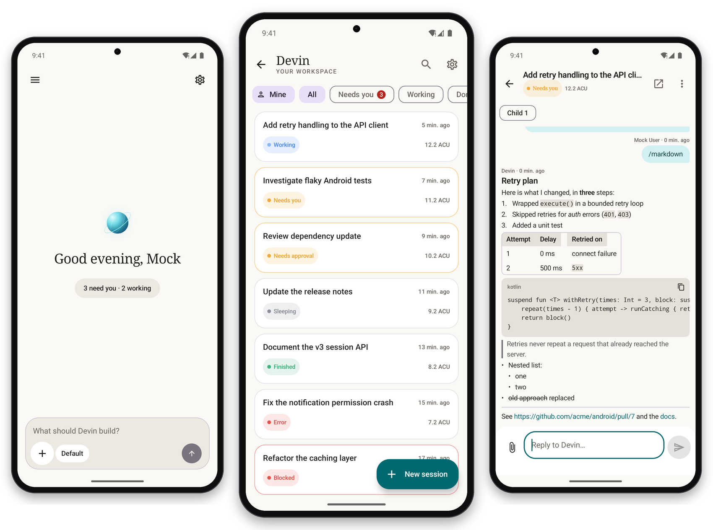
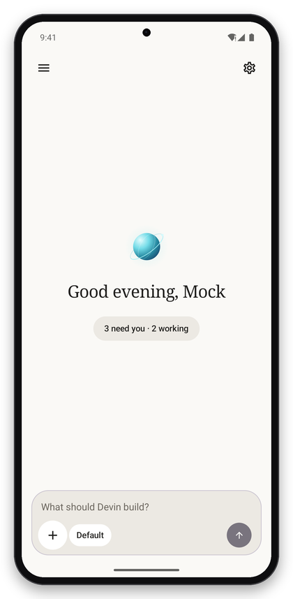
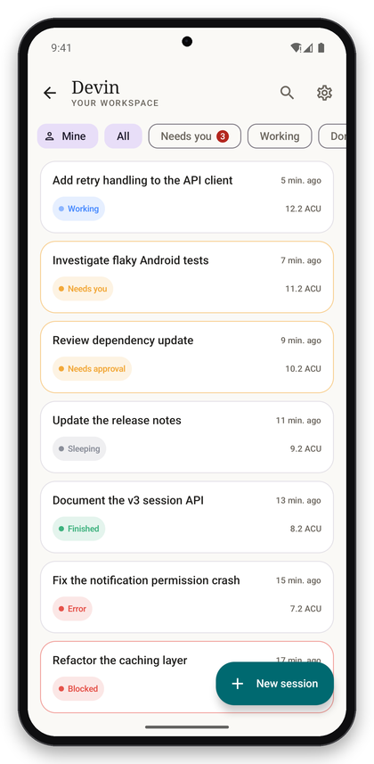
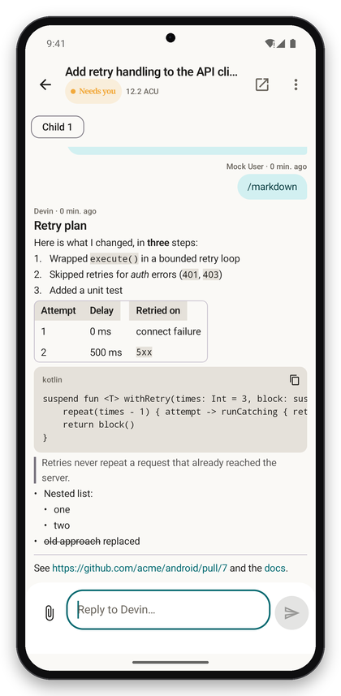
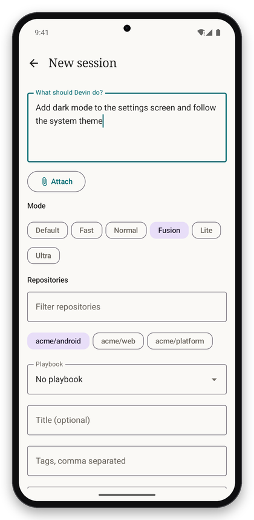
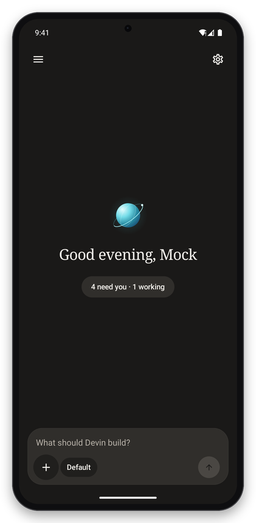
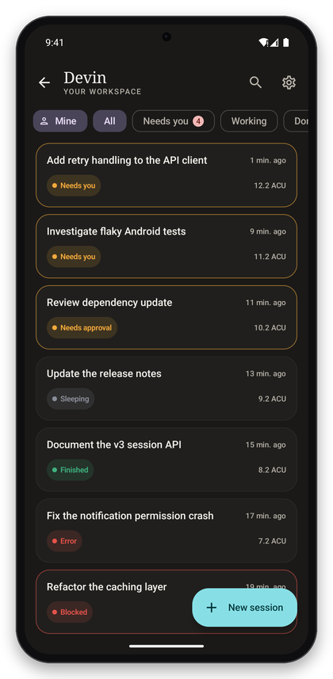
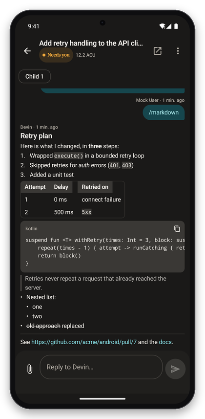
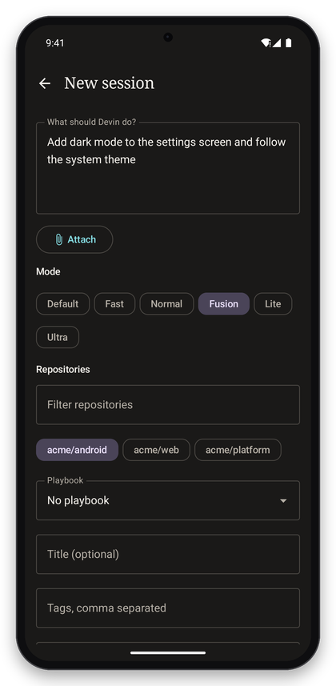

# Devin for Android

An unofficial native Android client for managing Devin sessions from your phone. Not affiliated with Cognition.

<p align="center">
  <picture>
    <source media="(prefers-color-scheme: dark)" srcset="docs/screenshots/hero-dark.png">
    
  </picture>
</p>

## Features

- Browse sessions with state filters, search, and pins.
- Read and send Markdown chat messages, retry sends, and upload or download attachments.
- Create sessions with repositories, playbooks, Devin mode, and ACU limits.
- Sleep, archive, or terminate sessions.
- Receive session notifications with inline reply; open sessions from `app.devin.ai/sessions/...` links.
- Share text to Devin, use the launcher shortcut, and browse the offline session cache.
- Store API keys with Android encrypted storage.

## Screenshots

| | Home | Sessions | Chat | New session |
| --- | --- | --- | --- | --- |
| **Light** |  |  |  |  |
| **Dark** |  |  |  |  |

Captured from a debug build running against `tools/mock_devin_api.py`; no real account data. Frame new captures with `python3 tools/frame_screenshots.py RAW_DIR docs/screenshots`.

## Get an API key

In Devin, open **Settings → Service users** and create a service-user key beginning with `cog_`. The key needs permission to access sessions. An organization ID is only needed when the key spans multiple organizations. For service-user keys, set **Act as user ID** in the app when required by your organization.

## Install

Download the APK from the GitHub Actions `devin-android-apks` artifact or a release. Enable installation from unknown sources for the app used to open the APK, then install it.

Latest main APK: [Download devin-android.apk](https://github.com/Blazikener/devin-android/releases/latest/download/devin-android.apk).

## Build from source

Install Android SDK and JDK 17, then run:

```sh
./gradlew assembleDebug
```

## Run against the mock API

From the repository root:

```sh
python3 tools/mock_devin_api.py
```

Use a debug build (`./gradlew installDebug`): release builds, including the published APK, only allow HTTPS, so they can't reach the mock over `http://`. In the app's **Advanced** sign-in settings, set the base URL to `http://10.0.2.2:8787` and the API key to `cog_mock`. Send `/markdown` in any session to get a long Markdown reply (table, code, lists, quote) for testing the chat renderer.

## Known limits

The API does not support approving pending actions, interactive shell, or IDE access; the app links out to Devin on the web for those tasks. Background session checks use WorkManager, which runs no more frequently than every 15 minutes; refresh is live while the app is open.
